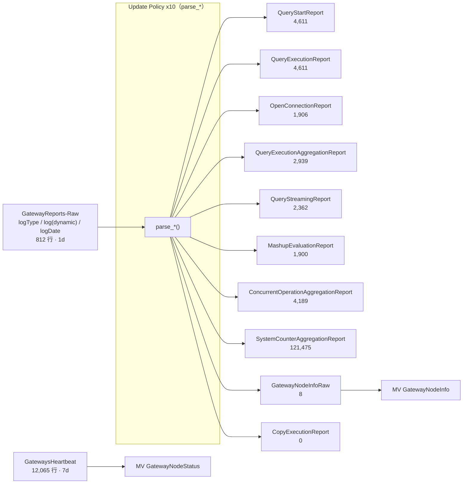

# Eventhouse 结构总览 — Gateway Monitoring

- **采集时间**: 2026-11-17T14:56:00+08:00
- **数据库级保留策略**: SoftDeletePeriod = 365000.00:00:00，Recoverability = Enabled

## 概览

| 指标 | 数量 |
|---|---|
| 物理表 | 12 |
| 物化视图 | 2 |
| 存储函数 | 15 |
| Update Policy | 10 |
| 总行数 | 156,878 |

## 数据流



## 1. 表清单

| 表 | Folder | 列数 | 行数 | 保留期 | 热缓存 | Update Policy |
|---|---|---:|---:|---|---|---|
| `GatewayReports-Raw` | Raw | 3 | 812 | 1 d | 1 d | — |
| `GatewayNodeInfoRaw` | Raw | 17 | 8 | 3650 d | 90 d | ✅ |
| `QueryStartReport` | Reports | 18 | 4,611 | 3650 d | 90 d | ✅ |
| `QueryExecutionReport` | Reports | 15 | 4,611 | 3650 d | 90 d | ✅ |
| `QueryExecutionAggregationReport` | Reports | 13 | 2,939 | 3650 d | 90 d | ✅ |
| `QueryStreamingReport` | Reports | 9 | 2,362 | 3650 d | 90 d | ✅ |
| `OpenConnectionReport` | Reports | 9 | 1,906 | 3650 d | 90 d | ✅ |
| `MashupEvaluationReport` | Reports | 17 | 1,900 | 3650 d | 90 d | ✅ |
| `ConcurrentOperationAggregationReport` | Reports | 7 | 4,189 | 3650 d | 90 d | ✅ |
| `CopyExecutionReport` | Reports | 7 | 0 | 3650 d | 90 d | ✅ |
| `SystemCounterAggregationReport` | System | 7 | 121,475 | 3650 d | 90 d | ✅ |
| `GatewaysHeartbeat` | System | 7 | 12,065 | 7 d | 1 d | — |

**备注**

- `GatewayReports-Raw`: 唯一摄入入口；仅保留 1 天，解析失败无回补窗口
- `GatewayNodeInfoRaw`: Raw 源 logType 已被 1 天保留期清除，表因自身 3650 天保留期仍有 8 行
- `MashupEvaluationReport`: 含空格列名，查询需使用 ['AverageCommit byte'] 形式
- `CopyExecutionReport`: 0 行；Raw 表中从未出现 logType == CopyExecutionReport
- `GatewaysHeartbeat`: 直接摄入，不经过 Raw → update policy 通路；网关状态 MV 的源表

## 2. 列结构

### `GatewayReports-Raw` (Raw, 3 列)

| # | 列名 |
|---:|---|
| 1 | `logType` |
| 2 | `log` |
| 3 | `logDate` |

### `GatewayNodeInfoRaw` (Raw, 17 列)

| # | 列名 |
|---:|---|
| 1 | `clusterId` |
| 2 | `clusterName` |
| 3 | `nodeId` |
| 4 | `machine` |
| 5 | `cloudDatasourceRefresh` |
| 6 | `contactInformation` |
| 7 | `customConnectors` |
| 8 | `status` |
| 9 | `type` |
| 10 | `version` |
| 11 | `versionStatus` |
| 12 | `osName` |
| 13 | `osVersion` |
| 14 | `cores` |
| 15 | `logicalCores` |
| 16 | `memoryGb` |
| 17 | `logDate` |

### `QueryStartReport` (Reports, 18 列)

| # | 列名 |
|---:|---|
| 1 | `GatewayObjectId` |
| 2 | `RequestId` |
| 3 | `DataSource` |
| 4 | `QueryTrackingId` |
| 5 | `QueryExecutionStartTimeUTC` |
| 6 | `OperationType` |
| 7 | `QueryText` |
| 8 | `Table` |
| 9 | `EvaluationContext` |
| 10 | `ServiceName` |
| 11 | `CurrentActivityId` |
| 12 | `ItemId` |
| 13 | `QueryType` |
| 14 | `RootActivityId` |
| 15 | `SKU` |
| 16 | `WorkspaceId` |
| 17 | `HostContextType` |
| 18 | `ConnectionIds` |

### `QueryExecutionReport` (Reports, 15 列)

| # | 列名 |
|---:|---|
| 1 | `GatewayObjectId` |
| 2 | `RequestId` |
| 3 | `DataSource` |
| 4 | `QueryTrackingId` |
| 5 | `QueryExecutionEndTimeUTC` |
| 6 | `QueryExecutionDuration_ms_` |
| 7 | `QueryType` |
| 8 | `DataReadingAndSerializationDuration_ms_` |
| 9 | `SpoolingDiskWritingDuration_ms_` |
| 10 | `SpoolingDiskReadingDuration_ms_` |
| 11 | `SpoolingTotalDataSize_byte_` |
| 12 | `DataProcessingEndTimeUTC` |
| 13 | `DataProcessingDuration_ms_` |
| 14 | `Success` |
| 15 | `ErrorMessage` |

### `QueryExecutionAggregationReport` (Reports, 13 列)

| # | 列名 |
|---:|---|
| 1 | `GatewayObjectId` |
| 2 | `AggregationStartTimeUTC` |
| 3 | `AggregationEndTimeUTC` |
| 4 | `DataSource` |
| 5 | `Success` |
| 6 | `AverageQueryExecutionDuration_ms_` |
| 7 | `MaxQueryExecutionDuration_ms_` |
| 8 | `MinQueryExecutionDuration_ms_` |
| 9 | `QueryType` |
| 10 | `AverageDataProcessingDuration_ms_` |
| 11 | `MaxDataProcessingDuration_ms_` |
| 12 | `MinDataProcessingDuration_ms_` |
| 13 | `Count` |

### `QueryStreamingReport` (Reports, 9 列)

| # | 列名 |
|---:|---|
| 1 | `GatewayObjectId` |
| 2 | `RequestId` |
| 3 | `DataSource` |
| 4 | `QueryTrackingId` |
| 5 | `StreamingStartTimeUTC` |
| 6 | `SpoolingDiskReadingDuration_ms_` |
| 7 | `StreamingDuration_ms_` |
| 8 | `Success` |
| 9 | `ErrorMessage` |

### `OpenConnectionReport` (Reports, 9 列)

| # | 列名 |
|---:|---|
| 1 | `GatewayObjectId` |
| 2 | `RequestId` |
| 3 | `DataSource` |
| 4 | `OpenConnectionStartTimeUTC` |
| 5 | `OpenConnectionTrackingId` |
| 6 | `ProviderName` |
| 7 | `OpenConnectionDuration_ms_` |
| 8 | `Success` |
| 9 | `ErrorMessage` |

### `MashupEvaluationReport` (Reports, 17 列)

| # | 列名 |
|---:|---|
| 1 | `GatewayObjectId` |
| 2 | `QueryTrackingId` |
| 3 | `ConnectionId` |
| 4 | `DataSourceKinds` |
| 5 | `DataSourcePaths` |
| 6 | `EndTimeUTC` |
| 7 | `AverageCommit byte` |
| 8 | `AverageIODataBytesPerSecond` |
| 9 | `AveragePercentProcessorTime` |
| 10 | `AverageWorkingSet byte` |
| 11 | `MaxCommit byte` |
| 12 | `MaxIODataBytesPerSecond` |
| 13 | `MaxPercentProcessorTime` |
| 14 | `MaxWorkingSet byte` |
| 15 | `TotalBytes` |
| 16 | `TotalProcessorTime` |
| 17 | `TotalRows` |

### `ConcurrentOperationAggregationReport` (Reports, 7 列)

| # | 列名 |
|---:|---|
| 1 | `GatewayObjectId` |
| 2 | `AggregationStartTimeUTC` |
| 3 | `AggregationEndTimeUTC` |
| 4 | `CounterName` |
| 5 | `Max` |
| 6 | `Min` |
| 7 | `Average` |

### `CopyExecutionReport` (Reports, 7 列)

| # | 列名 |
|---:|---|
| 1 | `GatewayObjectId` |
| 2 | `ActivityId` |
| 3 | `CopyExecutionStartTimeUTC` |
| 4 | `CompletionStatus` |
| 5 | `CopyExecutionDuration_ms` |
| 6 | `CopyWorkerCPUUtilizationPercentage` |
| 7 | `CopyWorkerMemoryUsage_byte` |

### `SystemCounterAggregationReport` (System, 7 列)

| # | 列名 |
|---:|---|
| 1 | `GatewayObjectId` |
| 2 | `AggregationStartTimeUTC` |
| 3 | `AggregationEndTimeUTC` |
| 4 | `CounterName` |
| 5 | `Max` |
| 6 | `Min` |
| 7 | `Average` |

### `GatewaysHeartbeat` (System, 7 列)

| # | 列名 |
|---:|---|
| 1 | `GatewayId` |
| 2 | `FileVersion` |
| 3 | `ServerTimestampUTC` |
| 4 | `Responding` |
| 5 | `ProcessName` |
| 6 | `ProductVersion` |
| 7 | `StartTime` |

## 3. Update Policy

| 目标表 | 源表 | 查询 | 启用 | 事务性 | 传播摄入属性 |
|---|---|---|---|---|---|
| `ConcurrentOperationAggregationReport` | `GatewayReports-Raw` | `parse_ConcurrentOperationAggregationReport()` | ✅ | ✅ | ❌ |
| `CopyExecutionReport` | `GatewayReports-Raw` | `parse_CopyExecutionReport()` | ✅ | ✅ | ❌ |
| `GatewayNodeInfoRaw` | `GatewayReports-Raw` | `parse_GatewayNodeInfoRaw()` | ✅ | ✅ | ❌ |
| `MashupEvaluationReport` | `GatewayReports-Raw` | `parse_MashupEvaluationReport()` | ✅ | ✅ | ❌ |
| `OpenConnectionReport` | `GatewayReports-Raw` | `parse_OpenConnectionReport()` | ✅ | ✅ | ❌ |
| `QueryExecutionAggregationReport` | `GatewayReports-Raw` | `parse_QueryExecutionAggregationReport()` | ✅ | ✅ | ❌ |
| `QueryExecutionReport` | `GatewayReports-Raw` | `parse_QueryExecutionReport()` | ✅ | ✅ | ❌ |
| `QueryStartReport` | `GatewayReports-Raw` | `parse_QueryStartReport()` | ✅ | ✅ | ❌ |
| `QueryStreamingReport` | `GatewayReports-Raw` | `parse_QueryStreamingReport()` | ✅ | ✅ | ❌ |
| `SystemCounterAggregationReport` | `GatewayReports-Raw` | `parse_SystemCounterAggregationReport()` | ✅ | ✅ | ❌ |

`GatewaysHeartbeat` 与 `GatewayReports-Raw` 自身无 update policy（策略为 `[]`）。所有策略的 OwnerPrincipalDetails omitted from public repository snapshot.

### Parser 实现范式

所有 `parse_*` 函数结构一致：

```kusto
['GatewayReports-Raw']
| where logType == "<LogType>"
| project log
| mv-expand log
| evaluate bag_unpack(log) : ( <TypedSchema> )
| project <Columns>
```

要点：

- 通过 `logType` 字段路由，`bag_unpack` 配显式类型 schema 展开 dynamic
- 列名中的 `(ms)` / `(byte)` 在目标表中规范为 `_ms_` / `_byte_`
- `DataSource` 用 `replace_strings(dynamic_to_json(...))` 解开双层数组包装后再 `parse_json`

## 4. 函数

| 函数 | Folder | 签名 | 说明 |
|---|---|---|---|
| `parse_QueryStartReport_csv` | Parsers | `(T:(GatewayObjectId:guid,RequestId:guid,DataSource:dynamic,QueryTrackingId:guid,QueryExecutionStartTimeUTC:datetime,QueryType:string,QueryText:string,EvaluationContext:string))` | — |
| `parse_QueryStartReport` | UpdatePolicyFunctions | `()` | Function to extract data from QueryStartReport |
| `parse_QueryExecutionReport` | UpdatePolicyFunctions | `()` | Function to extract data from QueryExecutionReport |
| `parse_OpenConnectionReport` | UpdatePolicyFunctions | `()` | Function to extract data from OpenConnectionReport |
| `parse_QueryExecutionAggregationReport` | UpdatePolicyFunctions | `()` | Function to extract data from QueryExecutionAggregationReport |
| `parse_QueryStreamingReport` | UpdatePolicyFunctions | `()` | Function to extract data from QueryStreamingReport |
| `parse_MashupEvaluationReport` | UpdatePolicyFunctions | `()` | Function to extract data from MashupEvaluationReport |
| `parse_SystemCounterAggregationReport` | UpdatePolicyFunctions | `()` | Function to extract data from SystemCounterAggregationReport |
| `parse_ConcurrentOperationAggregationReport` | UpdatePolicyFunctions | `()` | Function to extract data from MashupEvaluationReport |
| `parse_GatewayNodeInfoRaw` | UpdatePolicyFunctions | `()` | Function to extract data from GatewayNodeInfo |
| `parse_CopyExecutionReport` | UpdatePolicyFunctions | `()` | Function to extract data from CopyExecutionReport |
| `GatewayNodeStatusWithInfo` | Functions | `()` | Function to merge the GatewayNodeInfo and Heartbeat |
| `QueryConnections` | Functions | `(DateSearch:datetime, DaysBack:int, AllGateways:bool, Gateways:dynamic, AllClusters:bool, Clusters:dynamic)` | Function to get Query Connections |
| `QueryExecutionUnified` | Functions | `(DateSearch:datetime, DaysBack:int, AllGateways:bool, Gateways:dynamic, AllClusters:bool, Clusters:dynamic)` | Function to merge the Query Start and Execution |
| `SystemCounters` | Functions | `(DateSearch:datetime, DaysBack:int, AllGateways:bool, Gateways:dynamic, AllClusters:bool, Clusters:dynamic)` | Function to get SystemCounters |

**封装层函数**（带统一网关/集群过滤参数，分析优先调用）：`QueryConnections`、`QueryExecutionUnified`、`SystemCounters`、`GatewayNodeStatusWithInfo`。

## 5. 物化视图

| MV | 源表 | 状态 | 健康 | 最后运行 | MaterializedTo |
|---|---|---|---|---|---|
| `GatewayNodeInfo` | `GatewayNodeInfoRaw` | Active | ✅ | 2026-11-17T06:45:26.2234557Z | 2026-11-17T06:44:05.5914379Z |
| `GatewayNodeStatus` | `GatewaysHeartbeat` | Active | ✅ | 2026-11-17T06:45:56.5394671Z | 2026-11-17T06:45:24.578156Z |

**`GatewayNodeInfo`**

```kusto
GatewayNodeInfoRaw | summarize arg_max(logDate, clusterId, clusterName, machine, cloudDatasourceRefresh, contactInformation, customConnectors, status, type, version, versionStatus, osName, osVersion, cores, logicalCores, memoryGb) by nodeId
```

**`GatewayNodeStatus`**

```kusto
GatewaysHeartbeat | project-rename nodeId = GatewayId, lastStatusDate = ServerTimestampUTC | summarize arg_max(lastStatusDate,FileVersion,Responding) by nodeId
```

## 6. 注意事项

1. **CopyExecutionReport 全链路无数据** — 表 0 行，且 Raw 表 logType 分布中不存在 CopyExecutionReport；update policy 已启用但源数据从未产生。
2. **Raw 表保留期仅 1 天** — GatewayReports-Raw 保留 1 天、热缓存 1 小时，而下游 3650 天。任何 parse 失败的重放/回补窗口不超过 24 小时。
3. **GatewayNodeInfoRaw 源日志已过期** — Raw 中已无 logType == GatewayNodeInfo；现有 8 行为 3650 天保留期下的历史残留，MV 仍靠这些行做 arg_max。
4. **两处 DocString 与实际不符** — parse_ConcurrentOperationAggregationReport 的 DocString 指向 MashupEvaluationReport；parse_GatewayNodeInfoRaw 的 DocString 指向 GatewayNodeInfo（MV 而非 Raw 表）。
5. **GatewaysHeartbeat 为旁路摄入** — 该表无 update policy，直接写入；仅有 7 天保留 / 1 天热缓存，是 GatewayNodeStatus MV 的唯一来源。
6. **未定义 ingestionbatching 策略** — 所有表使用默认批处理策略。

## 7. 复现用查询

```kusto
// 表 + 文件夹
.show tables | project TableName, Folder, DocString

// 全库 schema（JSON）
.show database schema as json

// update policy
.show table * policy update

// 保留 / 热缓存
.show table * policy retention | project EntityName, Policy
.show table * policy caching | project EntityName, Policy

// 函数
.show functions | project Name, Folder, DocString, Parameters

// 物化视图
.show materialized-views

// 各表行数
union withsource=T * | summarize Rows=count() by T
```